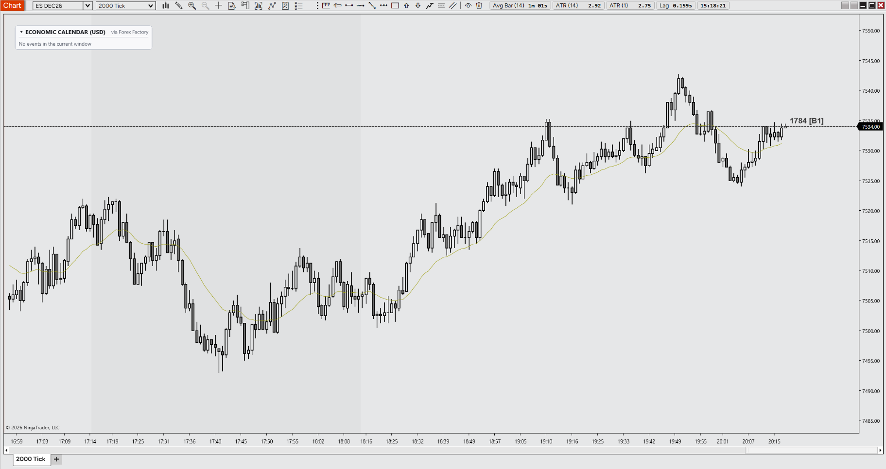

# icPriceAction — Clean NinjaTrader 8 Chart Template

A minimalist, high-contrast chart template engineered for **trading** on NinjaTrader 8. Designed to eliminate visual noise, remove grid clutter, and provide instant chart clarity.

---

## 📺 Video Walkthrough & Setup Guide

Watch the complete breakdown of every setting, color hex code, Chart Trader alignment, and hotkey configuration on YouTube:

> **[▶ Click here to watch the full configuration breakdown](https://youtube.com/@icPriceAction)**

---

## 🎨 Palette & Visual Specifications

| Element | Hex Code | Visual Style |
| :--- | :--- | :--- |
| **Chart Background** | `#FFE6E7E8` | Signature flat muted grey |
| **Bullish Bars (Up)** | `#FFE6E7E8` | Transparent (matches background) with 1.25px black outline |
| **Bearish Bars (Down)** | `#FF6E6E6E` | Solid slate grey with 1.25px black outline |
| **Candle Outlines & Wicks** | `#FF000000` | Solid black, 1.25px width |
| **Grid Lines (Horiz / Vert)**| *Disabled* | Completely unchecked to remove optical noise |
| **Chart Margin** | `200 px` | Ample right-side projection space |
| **Chart Trader Order Lines** | `55%` | Order brackets contained to the right half |

---

## 📥 One-Click Installation Guide

1. Download the **`icPriceAction.xml`** file from this repository.
2. On your Windows PC, navigate to your NinjaTrader 8 templates folder:
   `Documents\NinjaTrader 8\templates\Chart\`
3. Copy and paste **`icPriceAction.xml`** directly into that `Chart` folder.
4. Open **NinjaTrader 8** and open any chart.
5. Right-click anywhere on the chart ➔ **Templates** ➔ **Load**.
6. Select **`icPriceAction`** and click **Load**.
7. *(Optional)* To make this your default for all new charts: Right-click ➔ **Templates** ➔ **Save As...** ➔ name it `Default`.

---

## ☕ Support the Project

All templates, tools, and indicators by **icPriceAction** are 100% free and open-source. If this setup brings clarity to your charts and saves you configuration time, buying a coffee is the best way to support continued development:

> **[☕ Support Development on Buy Me a Coffee](https://buymeacoffee.com/icpriceaction)**

---

## ⚖️ Disclaimer

All software, templates, and content provided by icPriceAction are for educational and analytical purposes only. Nothing herein constitutes financial or trading advice. Futures trading involves substantial risk of loss. NinjaTrader® is a registered trademark of NinjaTrader, LLC.